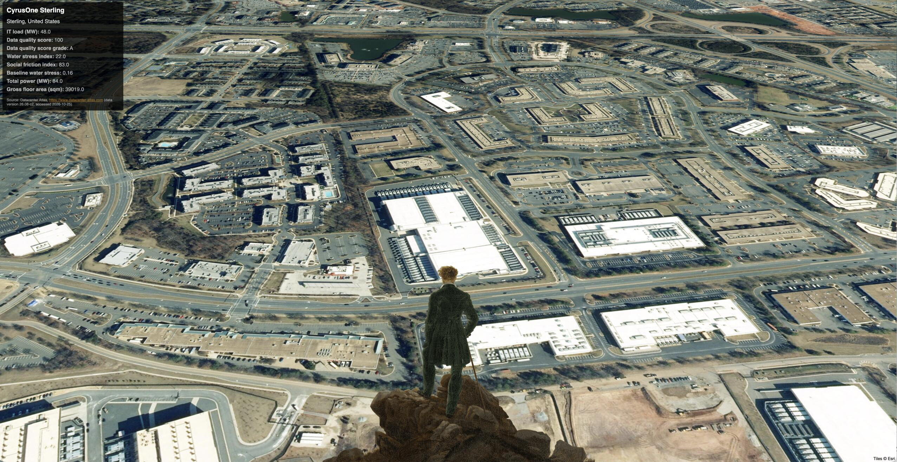

# El caminante sobre un mar de nubes

> El sujeto despierta de su sueño de 200 años y decide dar un paseo. Al encuentro de un paisaje alienígena se pregunta extrañado: «¿Pero qué estoy viendo? ¿Estoy soñando? ¿Alucinando?».



## Descripción

Caminante sobre un mar de nubes reinterpreta la célebre pintura de Caspar David Friedrich de 1818 en el contexto del paisaje contemporáneo de las infraestructuras de datos y la _nube_ como su representación _gaseosa_.  En este experimento, el _caminante_ recorre un conjunto de ~200 centros de datos, ordenados de mayor a menor según su área de superficie ocupada.  En cada visita se pueden ver algunas métricas sobre cada centro de datos.

## Datos y metodología

Datos tomados del sitio de [Data Center Atlas](https://www.datacenter-atlas.com/).  Este proyecto publica una muestra representativa de todo el conjunto de datos accesible en su sitio.  Los datos cuentan con una detallada documentación de su [metodología](https://www.datacenter-atlas.com/methodology) de elaboración y de sus [campos](https://www.datacenter-atlas.com/methodology/indicators).

Para este proyecto he tomado ese conjunto de datos y lo he filtrado y ordenado de forma descendente, por la columna de área del centro de datos (```gross_floor_area_sqm```).

## Referencias

Obra basada en la pintura 'Caminante sobre un mar de nubes, Caspar David Friedrich, Óleo sobre tela, 1818'

https://es.wikipedia.org/wiki/El_caminante_sobre_el_mar_de_nubes

Conjuntos de datos obtenidos de: 

- https://www.datacenter-atlas.com/
